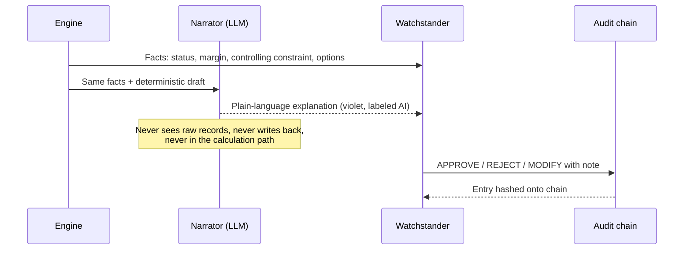
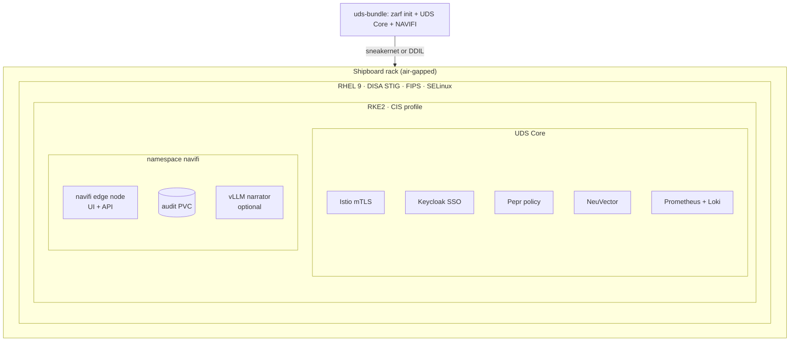

# NAVIFI architecture

NAVIFI answers one question for a watch team: **when a fact changes, what happens to the mission?** It computes the answer deterministically, shows how sure it is, offers bounded options, and records what the human decided. A language model may explain the answer. It never produces it.

## Data flow

```mermaid
flowchart LR
  subgraph Sources["Source systems (synthetic, read-only)"]
    OMMS[OMMS-NG<br/>CASREP / JCN]
    RSUP[R-Supply<br/>ETAs]
    NSIPS[NSIPS / AMCROSS<br/>personnel]
    HSM[HSM squadron<br/>aviation det]
    DLA[DLA tracking]
  end
  Sources -->|change events<br/>as patches| State["stateAt(t)<br/>node map"]
  State --> Engine
  subgraph Engine["Deterministic engine (src/engine)"]
    C[compute<br/>topological, monotone]
    CC[controlling constraint<br/>critical chain]
    SL[slack vs margin<br/>bisection]
    CL[cliffs]
    OP[options + packages]
    MC[seeded Monte Carlo]
  end
  Engine --> UI["Watch floor, graph, horizon,<br/>simulation, theater"]
  Engine -->|calculated facts only| LLM["Narrator (optional)<br/>OpenAI-compatible"]
  LLM -->|explanation text| UI
  UI -->|approve / reject / modify / STOP| Audit["SHA-256 hash chain"]
  Audit -->|store and forward| Edge["Edge node copy<br/>append-only JSONL"]
```

## The engine

The mission is a dependency graph. Every node kind has a monotone readiness rule, so a later input can never make the mission earlier, and bisection over any input is exact.

| Node | Ready when |
|---|---|
| `input` | Reported value; conservative `assumed` value if missing; worse value if sources contradict |
| `person` | First moment outside every unavailability interval |
| `task` | Predecessors ready, crew available, plus duration |
| `all` / `any` / `kofn` | Max / min / k-th earliest of dependencies |
| `gate` | First enabled delivery window the upstream can make, plus transit lag |
| `capability` | Dependencies ready; compared against `requiredBy` for margin and Y/Q/N |

On top of `compute()`:

- **Controlling constraint**: walk the binding predecessors back from the capability to the input, person, window, duration or crew that sets the time. Co-critical constraints are reported so nobody fixes one and misses the other.
- **Upstream slack vs. mission margin**: for each input, bisection finds how far it can slip with zero effect (`noImpact`) and how far before the mission fails (`toFailure`). The classic example: the part has 2 h slack and 3 h to failure; the team has none.
- **Cliffs**: scanning the consequence curve finds steps where one more increment of slip costs far more than the slip (missed sail date, missed fly-on window).
- **Options**: each lever is a set of patches. Singles and pairs are evaluated against the target capability, with side effects on the others. Levers carry their approval authority and deadline.
- **Monte Carlo**: triangular distributions on uncertain inputs, seeded PRNG (mulberry32). The same seed gives the same futures, so the run is reproducible and auditable. Runs stream incrementally so the UI stays live.

The engine has no I/O. It runs in the browser, so the full answer is available with the link down.

## AI boundary

- If the narrator is unavailable, disabled, or the ship is in EMCON, the deterministic template text is shown. Answers do not change.
- Approved options become **planning assumptions** inside NAVIFI. They do not issue orders, direct personnel, authorize maintenance, alter tasking, or write to any authoritative system.
- STOP suspends the narrative and options immediately and is itself logged.

## Audit

Every entry is `sha256(prev_hash + canonical_json(entry))`. The client keeps the chain; the edge server re-hashes each entry on receipt and appends it to `audit.jsonl`. The Decision Log screen can re-verify the chain, demonstrate a tamper, and restore the altered entry from the edge copy by hash.

## Disconnected operation

| Link | Behavior |
|---|---|
| SATCOM | Audit forwards in batches; shore model allowed if configured |
| DDIL | Audit trickles one entry at a time; local model or template |
| EMCON | Nothing leaves the ship; engine, map, simulation and audit all keep working |

The theater basemap is vector data bundled in the app (Natural Earth via world-atlas). No tile server.

## Deployment

See [DEPLOY.md](DEPLOY.md) for build and deploy steps.

## Repository map

| Path | What |
|---|---|
| `src/engine` | Deterministic engine, analysis, options, Monte Carlo (tested in `engine.test.ts`) |
| `src/data` | Scenarios as data: DDG 21-day readiness, classic radar repair, platform metadata |
| `src/routes`, `src/features` | Screens and their components |
| `server/index.ts` | Edge node API: health, metrics, audit, narrate |
| `deploy/chart/navifi` | Helm chart with UDS Package CR and optional vLLM |
| `zarf.yaml`, `uds-bundle.yaml` | Air-gap packaging |
| `compliance/oscal-component.yaml` | OSCAL component definition (generated by `ci/gen-oscal.ts`) |
| `ci/ai-review.mjs` | Advisory AI code review used by CI |
