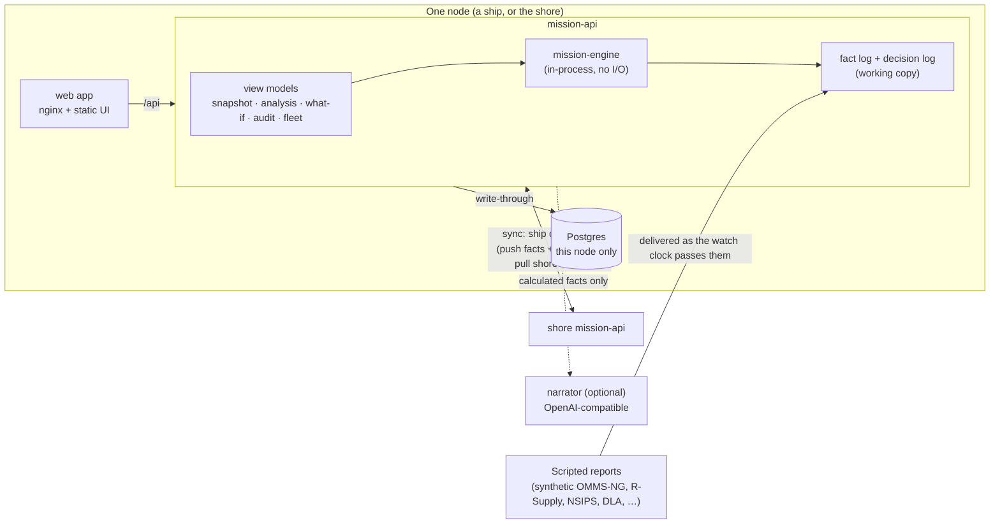
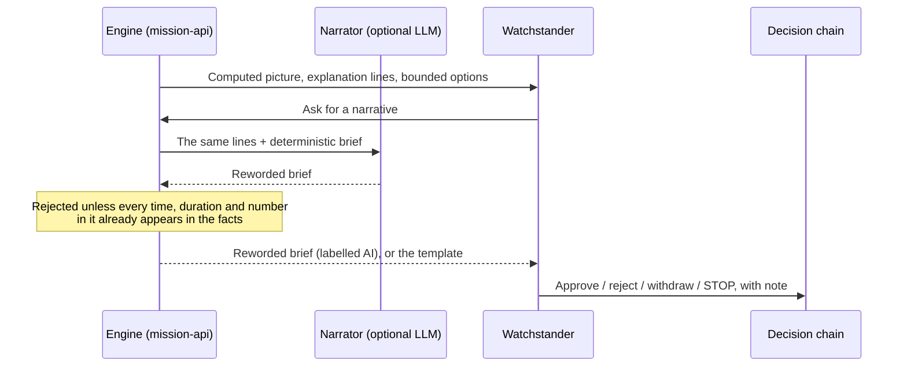

# HAWSIR architecture

HAWSIR answers one question for a watch team: **when a fact changes, what happens to the mission?** It computes the answer deterministically, shows how sure it is, offers bounded options, and records what the human decided. A language model may reword the explanation. It never produces the answer.

## Components and boundaries

- **The browser only talks to `/api`.** It never sees the database, the raw graph or another node's logs. It does no engine computation. It imports the API's view contract (types, time formatting, wire encoding) and the engine's hashing code, so it can re-verify chains itself.
- **mission-api is the only writer.** Every write is a reported fact or a decision, attributed to the caller and validated. Writes go through one queue per node, so the in-memory chains and the tables never diverge.
- **The engine has no I/O.** It runs the same in a test, in the API, or on a disconnected ship.

## Data plane

- **Facts** are bitemporal: when observed, when recorded, and (for facts that arrived over sync) when this node received them.
  - A fact's id is a hash of its content, so the same report has the same id on every node.
  - The chain hash also covers the local receipt time.
  - Reading "as of" t uses only facts this node knew at t. That is how the shore can show what it believed before the link came back.
- **Validation** happens at append. A malformed value (Marlowe's 142% fuel, an impossible date) is kept but **quarantined**: never used as a value, always shown as a flag.
- **Resolution** per entity and attribute picks the newest observation. Disagreeing sources are flagged **contradictory**, and the conservative value is chosen. Values past their age limit are flagged **stale**.
- **Decisions** form a second hash chain:
  - Kinds: approve, reject, withdraw, monitor, override, stop, resume, note.
  - Each records who decided, when, on which fact-log head and which result hash, and (for approvals) the exact patches.
  - Decisions must be recorded in time order.
- **Postgres** stores both logs per mission, append-only. On load the chains are rebuilt from content and compared with the stored rows, so a row edited in the database shows up as an integrity failure instead of a silent change.

## The engine

A domain pack compiles facts into a mission graph. The **naval** pack builds one from a fleet model (STEEL TIDE); the **authored** pack loads a hand-written graph whose values are bound to facts (ATLAS SHIELD). Every node kind has one meaning:

| Family | Nodes |
|---|---|
| Availability timelines | `event`, `window`, `person`, `task` (crew-constrained), `gate` (delivery slots), `delay`, `all`, `any`, `kofn`, `check`, `threshold`, `requirement` |
| Quantities | `stock` (fuel, missiles) with burns and transfers |
| Scalars | `scalar`, `routine` (registered, versioned, contract-checked leaf math such as transit time or fuel burn) |

A requirement's **margin** is `min(lead, tail, stock-hours)`:

- **lead**: how late it could come up;
- **tail**: how early it could be lost;
- **stock-hours**: how close a stock comes to its floor.

Status is Y / Q (below the Q threshold, or flagged) / N / UNK (required information missing).

On top of `compute()`:

- **Attribution.** A cause tree walks from the requirement's binding edge to the leaves that set the time: an input time, a person, a slot, a duration, a crew, a consumption. Leaves that bind together are reported as co-critical.
- **Slack vs. margin.** Bisection when the path is monotone, a scan otherwise. It gives `noImpact` (slip with zero effect) and `toFailure` (slip until the requirement is N).
- **Cliffs.** Steps in the consequence curve where one more hour of slip costs far more than an hour, usually a missed window.
- **Options.**
  - A lever is a named set of patches with an authority, an act-by time, a cost and a declared risk.
  - Singles and synergistic pairs are evaluated against the target, with side effects on every other requirement.
  - Exclusive alternatives are never paired.
- **Monte Carlo.** Triangular uncertainty on times, durations and burn rates, with a seeded PRNG: same seed, same futures.

## View layer (mission-api/src/views)

The screens were designed around a simpler engine. The view layer projects the new engine's results into those shapes without changing any number:

- the display class of each node;
- the ship part on the 3D twin;
- clamped "ready" times;
- explanation lines built only from computed results.

Unbounded values travel as `"Infinity"` / `"-Infinity"` and are revived in the browser. A margin with nothing limiting it is labelled `≥ <rest of horizon>` (`marginKind: atLeast`), never ∞.

Views are memoised on the content key of the picture: the time, plus the hash of the facts known then and the decisions made by then. A replay therefore costs one computation per distinct picture. The browser fetches pictures every hour of scenario time (15 minutes on an H-hour scale) and exactly at each report. The heavier analysis (slack, options, Monte Carlo) runs on a 6 h (1 h) step.

## The watch clock

The presenter drives time from the screen. mission-api's per-mission clock follows: before showing a time ahead of the clock, the browser moves the clock forward, which delivers every scripted report due by then. Looking back needs no move. Those moves are queued per mission, so two views can't race the clock backwards. Decisions are recorded at the time on screen.

In operational mode (`DEMO_MODE=0`) the clock follows the wall clock and cannot be moved.

## AI boundary

## Ship ⇄ shore

The ship node always dials out. While its link is up, every few seconds:

1. **Push.** The ship sends its new facts and decisions. The shore merges facts by content id (duplicates are dropped and nothing is overwritten). It keeps the ship's decision chain beside its own, verified, never merged.
2. **Pull.** The ship fetches shore facts it hasn't seen. The shore's sharing policy withholds other ships' personnel records.

When the link drops (a scripted SATCOM casualty, or the EMCON / DDIL buttons), nothing is lost: records queue aboard, hash-chained, and go in order when it returns.
