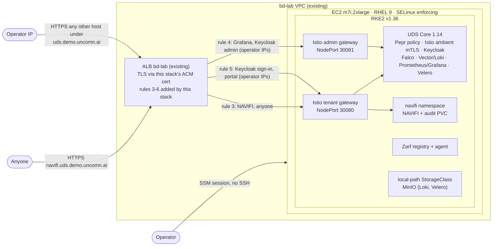

# NAVIFI lab cluster

The shipboard deployment from [docs/DEPLOY.md](../docs/DEPLOY.md), rehearsed ashore. NAVIFI runs on one EC2 node in the bd-infra lab account, on the stack it uses aboard: RHEL 9, RKE2 and Defense Unicorns' UDS Core, packaged with Zarf:

**https://navifi.uds.demo.uncomn.ai**

Terraform creates the node and its place behind the lab's existing load balancer. Three scripts on the node install RKE2, install UDS Core, and build and deploy NAVIFI from any git commit.

## Architecture



Only NAVIFI is public. Every other host under the domain, on either gateway, is forwarded only for source addresses in `operator_cidrs` (empty by default), and everyone else gets a 404 from the ALB (rule 6).

The lab already had a VPC, an ALB and a wildcard certificate for `*.demo.uncomn.ai`. This stack adds a node to that VPC instead of building a second network, because the lab's deploy role can create only the one load balancer named `bd-lab`. The bd-lab stack itself is never modified. This stack only adds to it: listener rules, a listener certificate for the two new wildcards, and egress rules on the ALB security group.

## What is here

| Path | Purpose |
|---|---|
| `terraform/` | Node, security group, IAM role, target groups, listener rules, ACM certificate, DNS |
| `terraform/user-data.sh` | First boot: SSM agent, Docker (build only), RKE2 host prerequisites, GitHub deploy key |
| `versions.env` | RKE2 and UDS CLI pins, with checksums |
| `cluster/install-rke2.sh` | Single-node RKE2 with SELinux, Istio kernel modules and limits, labelled volume path |
| `cluster/rke2-config.yaml` | RKE2 server config: SELinux on, bundled ingress controllers off |
| `cluster/prereqs/` | Zarf package deployed before Zarf init: default StorageClass, MinIO and its network policy |
| `cluster/uds-bundle.yaml` | Platform bundle: prereqs, Zarf init v0.89.0, UDS Core 1.14.3, with the lab overrides |
| `cluster/uds-config.yaml` | Non-secret bundle settings: Velero's MinIO endpoint and bucket |
| `cluster/install-core.sh` | Generates the node's secrets, then builds and deploys the platform bundle |
| `app/` | Zarf package for NAVIFI (same Helm chart as the ship package) and `deploy.sh` |

## Lab versus ship

The lab keeps the ship's software stack and packaging and changes only what an AWS demo needs.

| | Ship ([DEPLOY.md](../docs/DEPLOY.md), [ARCHITECTURE.md](../docs/ARCHITECTURE.md)) | Lab (this folder) |
|---|---|---|
| Delivery | One air-gapped UDS bundle carrying Zarf init, UDS Core and NAVIFI | Platform bundle, then NAVIFI built from a git commit on the node |
| Versions | Root `uds-bundle.yaml`: Zarf init v0.41.0, UDS Core 0.29.1, registry1 flavor (Iron Bank images) | Zarf init v0.89.0, UDS Core 1.14.3, upstream flavor |
| TLS | Terminated at the Istio gateways | ALB terminates with ACM; gateways serve HTTP on NodePorts only the ALB can reach. Pod-to-gateway HTTPS uses a CA generated on the node |
| Sign-in | Keycloak SSO in front of NAVIFI | Off, so judges can open the demo without an account |
| Host baseline | RHEL 9 with DISA STIG, FIPS and SELinux; RKE2 CIS profile | RHEL 9 with SELinux enforcing; STIG, FIPS and CIS not applied |

## Deploy

You need Terraform 1.10 or newer, the AWS CLI with the [Session Manager plugin](https://docs.aws.amazon.com/systems-manager/latest/userguide/session-manager-working-with-install-plugin.html), the `bd-infra-deployer` AWS credentials, a free account at [registry.defenseunicorns.com](https://registry.defenseunicorns.com) (UDS Core 1.x is published there), and admin rights on this GitHub repository to add a deploy key.

**1. Create the node and its routing** (about 5 minutes, mostly certificate validation).

```bash
export AWS_PROFILE=bd-infra-deployer
terraform -chdir=infra/terraform init \
  -backend-config="bucket=bd-infra-tfstate-<account id>" \
  -backend-config="key=lab/navifi-uds/terraform.tfstate" \
  -backend-config="region=us-east-1"
terraform -chdir=infra/terraform apply
# To also let your IP reach Grafana, Keycloak and the UDS portal:
# terraform -chdir=infra/terraform apply -var 'operator_cidrs=["203.0.113.7/32"]'
```

**2. Open a shell on the node.** First boot installs packages and reboots once; give it about five minutes.

```bash
eval "$(terraform -chdir=infra/terraform output -raw ssm_shell)"
```

**3. Clone the repository.** Add the node's public key as a read-only deploy key (GitHub: Settings > Deploy keys), then clone.

```bash
cat ~/.ssh/deploy_navifi.pub
git clone git@github.com:bschumacher-uncomn/HAWSIR.git navifi && cd navifi
```

**4. Install RKE2** (about 3 minutes). The script refuses to run until the first-boot reboot has happened.

```bash
sudo infra/cluster/install-rke2.sh
```

**5. Install UDS Core** (about 25 minutes). The first run asks for your UDS Registry username and token.

```bash
infra/cluster/install-core.sh
```

**6. Build and deploy NAVIFI** (about 5 minutes). This builds the tip of the default branch; pass a branch, tag or commit to deploy something else.

```bash
infra/app/deploy.sh
```

To ship a new commit later, run `infra/app/deploy.sh` again from `~/navifi`. It fetches first, and every commit gets its own image tag, so the Deployment always rolls.

## How NAVIFI gets deployed

`deploy.sh` exports the commit with `git archive`, builds the image with the repo's Dockerfile (which runs typecheck and the engine tests before it builds), and tags it `<version>-<commit>`. `uds zarf package create` wraps that image and `deploy/chart/navifi` into a Zarf package with an SBOM, taking the image from the local Docker daemon because it was never pushed to a registry. `uds zarf package deploy` then pushes the image into the in-cluster Zarf registry and installs the chart.

The chart emits a UDS `Package` resource. From it, the UDS operator exposes `navifi.<domain>` on the tenant gateway, generates the namespace's network policies (deny by default, then allow the gateway route, Prometheus scraping and traffic inside the namespace), and registers the Prometheus monitor on `/api/metrics`.

## Security

- **No SSH and no key pair.** The only way onto the node is an SSM session, authenticated by IAM and recorded in CloudTrail.
- **One inbound path.** The node's security group admits only the lab ALB's security group, and only on the two gateway HTTP ports and two health check ports.
- **Only NAVIFI is public.** Keycloak sign-in, the UDS portal, Grafana and the Keycloak admin console answer 404 unless the request comes from a CIDR in `operator_cidrs`.
- **Pods on the pod network cannot use the node's IAM role.** Instance metadata requires IMDSv2 with a hop limit of 1, which only the host network can satisfy. The role has only AWS's `AmazonSSMManagedInstanceCore` policy and carries the account's mandatory permissions boundary.
- **TLS at the edge.** The ALB terminates TLS with an ACM certificate. The ALB-to-node hop is plain HTTP inside the VPC, on ports nothing else can reach. Inside the cluster, UDS Core routes pods' requests for the gateway hostnames (Grafana signing in through Keycloak, for one) to each gateway's HTTPS port, which serves a certificate from a CA generated on the node and trusted through UDS Core's cluster trust bundle.
- **UDS Core enforcement** applies to NAVIFI like any other workload: Pepr admission policies (non-root, no privilege escalation, dropped capabilities), Istio ambient mTLS, network policies generated from each app's `Package`, Falco runtime detection, and central logs and metrics.
- **Storage is fenced too.** The storage prerequisites deploy before UDS Core and are exempt from its admission policies, so MinIO carries its own network policy that admits only Loki, Velero and MinIO's own bucket setup job.
- **Supply chain.** Zarf init and UDS Core are verified with Sigstore keyless signatures against their release workflows when the bundle is built. The RKE2 installer is fetched from its release tag and checked against a pinned SHA-256, and it installs Rancher's GPG-signed RPMs. The UDS CLI download is checked against a pinned SHA-256. Every NAVIFI package carries a Syft SBOM.
- **Secrets stay on the node.** The MinIO credentials and the gateway CA and key are generated on first install under `~/.config/navifi-lab` (readable only by ec2-user). They never enter git or Terraform state.
- **Docker is build-only.** It runs with no default bridge and no iptables rules, so it cannot interfere with Kubernetes networking.

SSO is off for NAVIFI in the lab on purpose, so judges can open the demo without an account. The ship package keeps it on (`uds.sso: true` in `deploy/values/zarf-values.yaml`).

## Sizing

Defense Unicorns asks for 12+ vCPUs and 32+ GiB for production UDS Core. Here it runs on 8 vCPU and 32 GiB with only its required components: the passthrough and egress gateways, Envoy Gateway and UDS Core's metrics-server stay off, and RKE2's own metrics-server is used instead. Keycloak keeps its default dev mode with an embedded database, where production would use an external one. The other trims are the ones Defense Unicorns applies in its own k3d demo bundle:

- Loki write, read and backend at 1 replica each
- Pepr watcher and admission requests at 200m CPU and 256Mi memory
- one Falco Sidekick replica

MinIO, standing in for cloud object storage, runs as a single replica requesting 512Mi, where the chart defaults to 16 replicas at 16Gi each.

`install-core.sh` ends by printing the node's allocated requests against what it can schedule. If pods stay Pending for CPU or memory, set `instance_type = "m7i.4xlarge"`.

## Cost

The node is on-demand `m7i.2xlarge` (US$0.4032 an hour for the compute in us-east-1) plus the hourly RHEL subscription fee, a 150 GB gp3 volume (about US$12 a month) and a public IPv4 address (about US$3.65 a month). The ALB is shared with the lab, and the certificate is free. To save money between demos, stop the instance. RKE2 and UDS Core come back on their own when it starts again.

## Checks

```bash
terraform -chdir=infra/terraform fmt -check -recursive
terraform -chdir=infra/terraform init -backend=false && terraform -chdir=infra/terraform validate
shellcheck -x infra/cluster/*.sh infra/app/deploy.sh infra/terraform/user-data.sh
uds zarf dev lint infra/cluster/prereqs
uds zarf dev lint infra/app --set IMAGE_TAG=check
```

## Tear down

The deploy role can request ACM certificates but not delete them. `destroy` removes everything else, then fails with AccessDenied on the certificate. Remove the certificate from state; an administrator can delete it later.

```bash
terraform -chdir=infra/terraform apply -var termination_protection=false
terraform -chdir=infra/terraform destroy   # ends with AccessDenied on aws_acm_certificate.uds
terraform -chdir=infra/terraform state rm aws_acm_certificate.uds
```
